# claude-mod-context-heat

A Claude Code mod that shows, at a glance, how full a session's context window is, whether anything is still running, and how the work is doing against its estimate. It is built around one habit: write the handoff and start a new session at about 600k tokens.


The row above the message box: work status, countdown, context figure and dots.

## What it does

Each session gets a row above the message box. It says whether work is running, counts down Claude's own time estimate, and shows how full the context is. In the desktop app a faint background of blocks fills up behind the conversation as the context grows. Near the limit the mod reminds you to write the handoff and start a new session. Every feature can be turned off on its own.

## Terms used

- **Context:** everything Claude reads on each turn: your messages, its replies, files it opened and tool results. It is counted in tokens (roughly three quarters of a word each), so `362k` means about 362,000 tokens.
- **Why 600k:** the context window holds far more, but a very long conversation gets slower, costs more per message, and Claude keeps track of early details less well. Around 600k is a good point to wrap up and start fresh. The figure is a constant you can change (see Good to know).
- **Handoff:** a short document saying where the work stands and what comes next, so a new session can pick it up without re-reading the old one.
- **Prompt cache, warm and cold:** after each message, Claude's service keeps the conversation it has already read for a short time. While it is kept (warm), your next message reuses it, so it is cheaper and starts faster. Once that time runs out (cold), the next message has to read the whole conversation again at full price. Nothing breaks and nothing is lost; it only costs more and takes a little longer. Warm is good. If you mean to carry on, reply before it goes cold.
- **Compaction:** when the context gets close to full, Claude Code shrinks the conversation into a summary to make room. Work carries on, but fine details from earlier can be lost, so after a compaction or two it is often better to write the handoff and start a new session.
- **Agent:** a helper Claude starts to do part of the work in parallel, such as a search or a test run. It has its own short task and reports back when done.
- **Background command or workflow:** a long command or multi-step job Claude started that keeps running after its reply ends, such as a test suite.
- **Estimate:** the total time Claude says a piece of work will take, stated as `Estimate: 10 minutes` before it starts.
- **Status line:** the short line of text under the message box.

## Features

Each feature has a switch name, used in both ways of turning it off (see below).

### Background (`backdrop`)

Faint blocks behind the conversation in the desktop app stack up and warm from blue to red as the context fills.

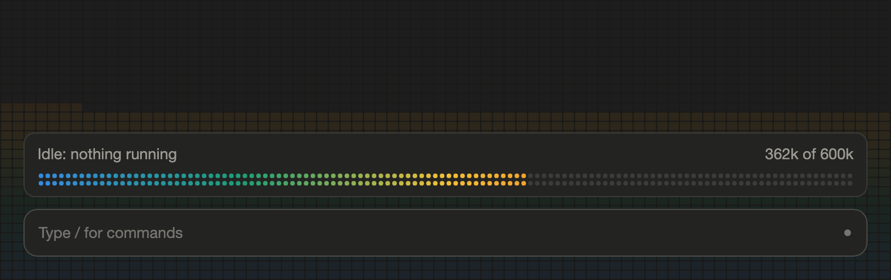

### Dots (`dots`)

A strip of 240 dots across the row, one for every 2.5k tokens. In the terminal it is a short line of text characters.

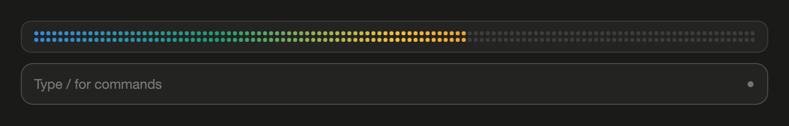

### Context figure (`contextFigure`)

The figure on the right of the row, for example `362k of 600k`.

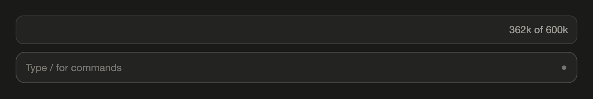

### Work status (`workStatus`)

`Working: Claude is replying`, `Working: 3 agents running` or `Idle: nothing running`.

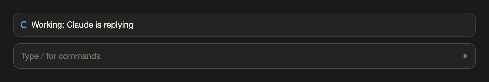

### Background work (`backgroundTasks`)

Background commands and workflows count as work, so a long command reads `Working: 1 command running`, not Idle. Needs `workStatus`.

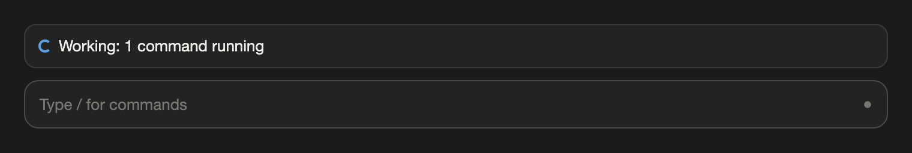

### Countdown (`countdown`)

When Claude states `Estimate: 10 minutes`, the row counts down (`6:40 left of 10 min`), then counts the overrun in amber (`3:12 over the 10 min estimate`).

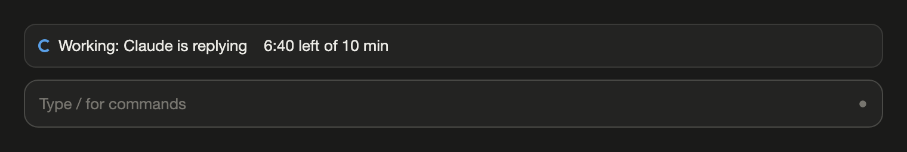

### Estimate note (`estimateNote`)

A short note on each prompt, about 70 tokens, asks Claude to state an estimate before any piece of work. Only added while `countdown` or `notifications` is on. It has no look of its own.

### Handoff warning (`handoffWarning`)

At 600k the status line reads `600k: write the handoff`, the figure turns to the warning colour and the background pulses slowly.

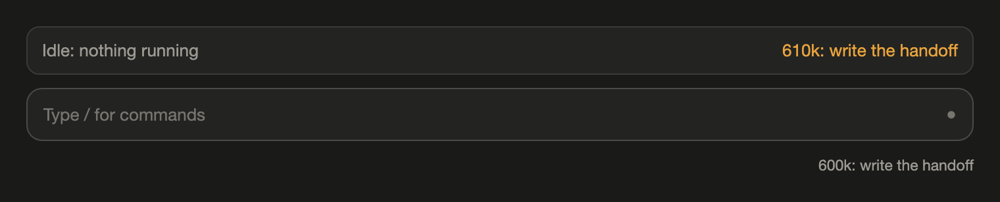

### Red past the limit (`redPastLimit`)

From 600k to 750k the dots and blocks deepen to dark red.

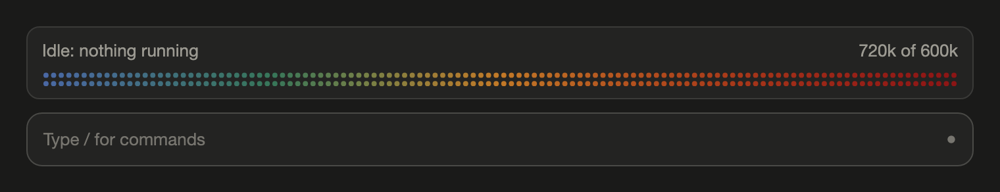

### Handoff nudge (`handoffNudge`)

Once per session, when the context first reaches 585k, a notice says `585k: run /handoff, then open a new session`. It also adds the `/handoff` command, which asks Claude to update the handoff document for the current work and then tell you to open a new session in that repo's folder.

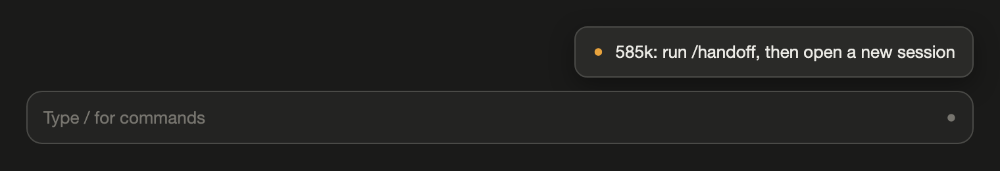

### Cache timer (`cacheTimer`)

On a small line under the dots, after a database icon: `Cache warm` while work runs, then a live `Cache cold in 4:59` once the session is idle (amber in the last minute), then `Cache cold`. Warm means your next message is cheaper and quicker; cold means it reads the whole conversation again at full price (see Terms used). The countdown tells you how long you have to reply while it is still warm.

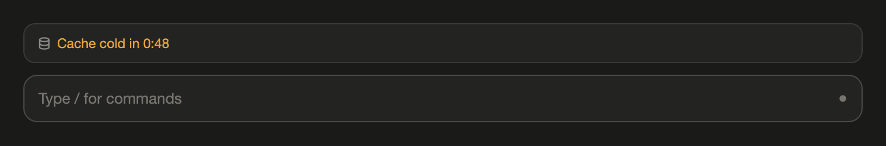

### Compaction count (`compactionCount`)

On the same small line, after an icon of two arrows pointing in: `Compacted 1 time` or `Compacted 3 times`. Hidden until the first compaction. Each compaction squeezes earlier detail into a summary, so a rising count is a sign to write the handoff and start a new session (see Terms used).

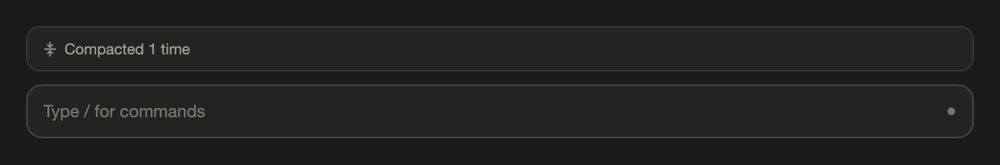

### Waiting on you (`waitingOnYou`)

While a question or a permission prompt waits on you, the row turns amber: `Waiting on you: a question is open, 6 min`.

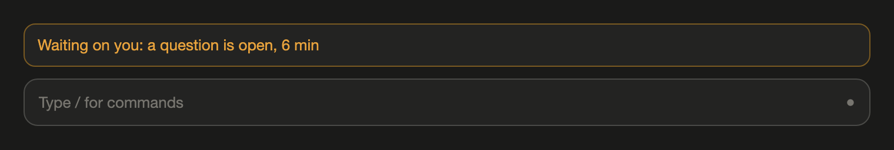

### Notifications (`notifications`)

A system notification when a session is done (`my-repo: done, estimate 25, actual 22`) or starts waiting on you (`my-repo: waiting on you`). Work under 30 seconds raises none.


### Agent list (`agentList`)

Click `3 agents running` to open a list of the agents under the row, each with its own countdown (`9:42 left of 12 min`, `3:05 over 15 min`, or `running 4:12` when the agent stated no estimate). Each agent is asked to state an estimate. The list starts closed. Needs `workStatus`.

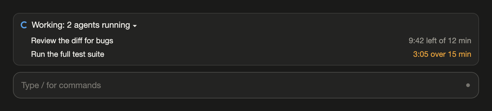

### Sleep fix (`sleepFix`)

Time the Mac spends asleep or the app spends closed is not counted, and reopening the app clears work that ended with it. It has no look of its own.

## Turning a feature off

A feature runs only while both routes below say it is on. Use either one.

### Route 1: the plugin's settings (recommended)

This route survives updates.

1. In a Claude Code session, type `/config` and press Enter.
2. Scroll to the rows for `context-heat`. There is one row per feature, named by its switch, for example `cacheTimer`.
3. Select the row of the feature you want off and set it to `false`.
4. Close the settings. The mod reloads with the new settings straight away.

The same values live in your `~/.claude/settings.json`, under `pluginConfigs`, in the entry for `context-heat`, under `options`. You can also turn a feature off there by hand: add for example `"cacheTimer": false` to that `options` block and save the file.

To turn the feature back on, set the row back to `true`.

### Route 2: edit the code

1. Find the mod's files.
   - If you installed it with `/plugin install`, they are in Claude Code's plugin cache: `~/.claude/plugins/cache/claude-mod-context-heat/context-heat/<version>/`. To be sure of the folder, run `claude plugin list` in a shell and read the line for `context-heat`.
   - If you cloned this repository, they are in your clone.
2. Open `hooks/register.tsx` in a text editor.
3. At the very top is the `FEATURES` list, one line per feature with a comment above it saying what it does.
4. Change `true` to `false` on the line of the feature you want off, for example `cacheTimer: false,`.
5. Save the file.
6. Start a new session, or type `/reload-plugins` in an open one.

An update of the mod (`claude plugin update`, or an automatic update) replaces the files in the plugin cache, so an edit there is lost. Use route 1 if you installed with `/plugin install`.

## Install

At the prompt of a terminal session:

```
/plugin install context-heat --marketplace hkdeven/claude-mod-context-heat
```

Answer `y` to add the marketplace, then press Enter to choose the user scope. The next screen lists the feature settings, all on; press Enter to keep them.

From a shell:

```
claude plugin install context-heat --marketplace hkdeven/claude-mod-context-heat
```

In the desktop app, where `/plugin` does not run: click **+** next to the prompt box, then **Plugins**, then **Add marketplace** with `hkdeven/claude-mod-context-heat`, then **Add plugin**.

Start a new session afterwards. Sessions that were already open pick the mod up when they restart.

## Good to know

- The background needs a Claude desktop app build that draws mod themes. The row works everywhere, the terminal included.
- The desktop app draws one background for the whole window, so in split view the blocks follow a single session. The row and its dots are always per session.
- A background command or workflow that was already running when the mod loaded is not counted, and neither is anything the app watches outside the session, such as a pull request's checks.
- The countdown reads an estimate in minutes from Claude's reply: `Estimate: 10 minutes`, `Estimate: about 5 min` or `On it. Estimate 25 min`. A report of finished work, such as `estimate 15 min, actual 2`, does not start one. A new estimate replaces a running one. It runs until the main turn has ended and no agent is still running. A countdown more than 4 hours over, or 3 times its estimate over if that is longer, is dropped as stale.
- The cache timer counts from the time of Claude's last request. Each reply reports how long its cache lasts (5 minutes or 1 hour) and the timer uses that. Where a reply does not say, the mod assumes 60 minutes: the constant `CACHE_TTL_MINUTES` in `hooks/register.tsx`.
- In auto mode the classifier answers most permission checks, so the row only says `Waiting on you` for a permission when a person is really being asked.
- Notifications go through your own notification setting in Claude Code. They are headed `context-heat` and named after the session's title, or the repo's folder when the session has none.
- The 600k limit is the constant `LIMIT`, and the nudge point is `NUDGE_AT`, both at the top of `hooks/register.tsx`.

## Develop

```
claude plugin validate .
```

```
claude plugin test .
```
