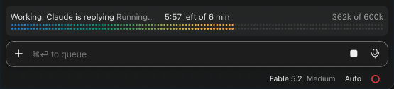

# claude-mod-context-heat

A Claude Code mod that shows, at a glance, how full a session's context window is, whether anything is still running, and how the work is doing against its estimate. It is built around one habit: write the handoff and start a new session at about 600k tokens.



The row above the message box: work status, countdown, context figure and dots.

## What it does

- **A row above the message box, one per session.** It says `Working: Claude is replying`, `Working: 3 agents running`, `Working: 1 command running` or `Idle: nothing running`, with the session's own figure (`283k of 600k`) and a strip of 240 dots, one for every 2.5k tokens. The dots run from cool blue through green, yellow and orange to red.
- **A work countdown.** When Claude states an estimate, for example `Estimate: 10 minutes`, the row counts down (`6:40 left of 10 min`). Past zero it turns amber and counts the overrun (`3:12 over the 10 min estimate`). It clears when the session goes idle. So that there is always one to show, the mod attaches a short note to each prompt asking Claude to state an estimate before any piece of work.
- **A faint background of small blocks in the desktop app.** They stack up from the bottom of the window and warm in the same colours as the context grows.
- **At 600k** the row reads `600k: write the handoff` and the background pulses slowly. From 600k to 750k everything deepens to dark red.

The display reads the session's own state. The only tokens it adds are the estimate note, about 70 per prompt.

## Install

At the prompt of a terminal session:

```
/plugin install context-heat --marketplace hkdeven/claude-mod-context-heat
```

Answer `y` to add the marketplace, then press Enter to choose the user scope.

From a shell:

```
claude plugin install context-heat --marketplace hkdeven/claude-mod-context-heat
```

In the desktop app, where `/plugin` does not run: click **+** next to the prompt box, then **Plugins**, then **Add marketplace** with `hkdeven/claude-mod-context-heat`, then **Add plugin**.

Start a new session afterwards. Sessions that were already open pick the mod up when they restart.

## Good to know

- The background needs a Claude desktop app build that draws mod themes. The row works everywhere, the terminal included.
- The desktop app draws one background for the whole window, so in split view the blocks follow a single session. The row and its dots are always per session.
- Running agents, background commands and background workflows all count as work, so a session waiting on a long command reads `Working: 1 command running`, not Idle. A command or workflow that was already running when the mod loaded is not counted, and neither is anything the app watches outside the session, such as a pull request's checks.
- The countdown reads an estimate in minutes from Claude's reply: `Estimate: 10 minutes`, `Estimate: about 5 min` or `On it. Estimate 25 min`. A report of finished work, such as `estimate 15 min, actual 2`, does not start one. A new estimate replaces a running one.
- The countdown runs until the main turn has ended and no agent is still running, so it keeps counting while background agents work.
- In the terminal the dots are drawn as a short line of text characters.
- The 600k limit is a constant, `LIMIT`, at the top of `hooks/register.tsx`.

## Develop

```
claude plugin validate .
```

```
claude plugin test .
```
